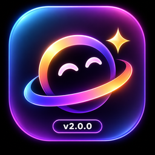

# Emo-Xpress

<p align="center">
  
</p>

<h2 align="center">Every emotion. One expression.</h2>
<p align="center">A local-first Windows emoji library and expression assistant.</p>
<p align="center">Windows 10/11 · x64 · Version 2.0.0</p>

<p align="center">
  <a href="https://github.com/kosandra0/Emo-Xpress/releases">Releases</a> ·
  <a href="CHANGELOG.md">Changelog</a> ·
  <a href="RELEASE_NOTES_v2.0.0.md">v2.0.0 release notes</a> ·
  <a href="PRIVACY.md">Privacy</a> ·
  <a href="THIRD_PARTY_NOTICES.md">Third-party notices</a>
</p>

---

## Version 2.0.0

Emo-Xpress is a Windows desktop emoji library, organiser and expression assistant. Browse the Unicode catalogue, organise collections, create reusable combinations, or describe what you want to express and receive emoji suggestions.

**The core Expression Studio works offline.** Optional Anthropic assistance is off by default and is never required for local features.

## Downloads

The v2.0.0 installer and standalone executable have been built and verified. Their release files are prepared, but they have not yet been attached to a GitHub Release. Check the [Releases page](https://github.com/kosandra0/Emo-Xpress/releases) for publication.

| File | Size | SHA-256 |
|---|---:|---|
| `Emo-Xpress_2.0.0_x64-setup.exe` (recommended installer) | 4,719,856 bytes | `09bad3c988b0763f971f0172c0d453582925920cacebb66c99851952ed8eb972f` |
| `Emo-Xpress_2.0.0_windows-x64_standalone.exe` | 7,789,568 bytes | `a2a88952145874484582007b57280104b4492368f46ae1f6aa18e8b53c67b26b` |

Verify a downloaded installer before running it:

```powershell
Get-FileHash .\Emo-Xpress_2.0.0_x64-setup.exe -Algorithm SHA256
```

The installer is **not code-signed**. Windows SmartScreen may show a warning. Compare the SHA-256 with `SHA256SUMS.txt` before choosing **More info → Run anyway**.

## What's new

### Expression Studio

Describe a feeling or provide a sentence and get emoji suggestions in six modes:

1. Express an idea.
2. Emoji-only summary.
3. Add emoji to your text.
4. Adjust the tone.
5. Create a reply idea.
6. Explain an expression.

Choose from 12 contexts plus a custom context, five tone controls, and three strict output styles:

- **Minimal:** 1–2 emoji.
- **Balanced:** 3–4 emoji.
- **Expressive:** 5–7 emoji.

Suggestions include concise explanations and preserve exact Unicode sequences. The local engine uses a built-in English vocabulary; unknown words are identified rather than guessed.

### Contextual suggestions and semantic search

Optional suggestion panels can offer ideas in the emoji library, collections and saved combinations. They are **off by default**. “Suggest by meaning” is available from a no-results search and runs only when pressed. Existing ordinary emoji search remains unchanged.

### Personalisation

- User-controlled defaults for context, tone, result count and preferred expression length.
- Up to 20 saved presets.
- Optional expression history, off by default.
- Raw prompt text is retained only with separate consent.
- Useful / Not useful feedback, favourite patterns and reset controls.

### Optional AI assistance

AI assistance is **off by default**. When enabled, the user reviews a consent disclosure and explicitly presses “Improve with AI”. The optional provider can re-rank only candidates selected by the offline engine. Requests go to the fixed `api.anthropic.com` host over HTTPS from the Rust side. The API key is stored in Windows Credential Manager or in session memory; it is not stored in the app database, returned to JavaScript or written to logs. Provider responses are schema-checked and candidate IDs are allowlisted. Failures fall back to local suggestions.

Using your own Anthropic API key may incur charges from your provider. No API key or subscription is required for offline features. The real provider request was **not live-tested** during this release because no API key was available; mock and test-double coverage passed.

## Preserved features

- 3,963 fully-qualified Unicode Emoji 18.0 catalogue entries, with English CLDR 49 names and annotations.
- Nine categories, ranked search and a keyboard-accessible virtualised grid.
- Favorites and Recently Used.
- Exact clipboard copying, including flags, keycaps, skin tones, tag sequences and ZWJ sequences.
- Personal collections, folders and saved combinations.
- 18 application themes and 10 Emoji Name Styles.
- Update Logs, About information and Windows desktop integration.

## Installation and upgrade

Close Emo-Xpress before installing. The per-user installer installs under `%LOCALAPPDATA%\Emo-Xpress`; application data stays under `%APPDATA%\com.emoxpress.desktop`.

Upgrading from 1.x preserves Favorites, Recently Used, collections, folders, combinations and settings. Version 2.0.0 adds no new SQLite migration; it stores bounded, versioned settings in the existing `app_settings` table. The 1.1.1 compatibility/rollback path was verified in Windows Sandbox. Version 1.0.1 cannot open a database after migration 0002 has been applied, so retain a backup when upgrading from that older version.

## Verification

- **3,300 / 3,300** frontend tests passed across 58 files, run sequentially.
- **19** Rust tests passed.
- TypeScript typecheck, lint, Rust formatting, Cargo check and Clippy passed; Clippy reported 0 warnings.
- Unicode catalogue validation: 27 / 27 checks, 3,963 entries.
- `npm audit --omit=dev`: 0 production vulnerabilities.
- Windows Sandbox fresh install, launch, shortcut creation, graceful close and uninstall passed.

## Known limitations

- The expression vocabulary is English-only and contains about 3,000 phrases.
- On an independent set of 120 prompts, the first suggestion contained an expected emoji for 75%; at least one of four suggestions did so for 87.5%. These are measured results, not a guarantee of correctness.
- The Anthropic path was not tested against the live service because no API key was available.
- The installer is unsigned.
- A real screen-reader session and a physical Windows display-scaling change were not tested; scaling was emulated.
- `cargo audit` was not run because the tool was not installed.

## Privacy

Emo-Xpress has no account, telemetry, analytics or cloud profile. Core features use the bundled catalogue and local SQLite data. The app does not read clipboard contents. Network access is used only if optional AI assistance is enabled and the user explicitly invokes it. See [PRIVACY.md](PRIVACY.md) for details.

## Technology

Tauri 2, Rust, React 19, TypeScript, Vite, SQLite, Unicode Emoji 18.0, CLDR 49 and Noto Color Emoji 2.057. See [THIRD_PARTY_NOTICES.md](THIRD_PARTY_NOTICES.md).

## Repository contents and licence

This public repository contains public-facing release documentation, checksums and visual assets. It does **not** publish the application's full source tree. No project software licence has been selected or added yet; do not assume that the application source or original artwork is licensed for reuse. Third-party materials remain subject to their respective licences.

---

<p align="center"><strong>Emo-Xpress · Every emotion. One expression.</strong></p>
